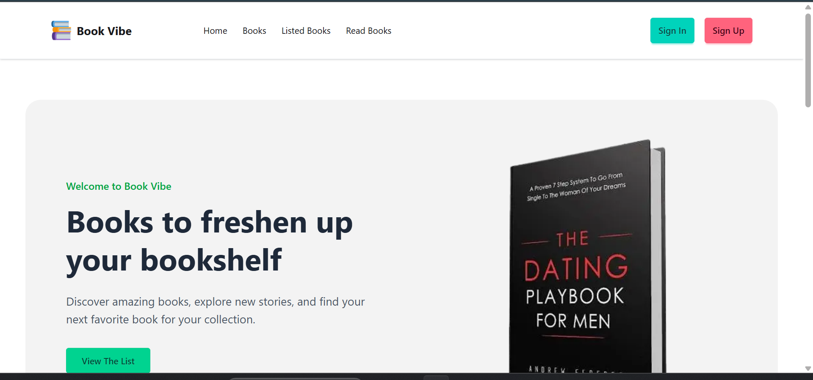

<div align="center">

# 🏋️ FitLog

### Plan Your Workouts. Track Your Progress.

**Build Better Habits. Stay Strong. Keep Moving.**

A modern and responsive workout planning application that helps users explore exercises, create daily workout plans, save workouts, and track their fitness routine.

<br/>

[](https://fitlog-black-two.vercel.app/)
[](https://nextjs.org/)
[](https://www.typescriptlang.org/)

</div>

---

## 📸 Project Preview

<p align="center">
  
</p>

<p align="center">
  <i>FitLog — Your personal workout planning companion.</i>
</p>

---

## 📖 About The Project

**FitLog** is a modern workout planning application designed to make daily fitness routines easier to organize and manage.

Users can explore a workout library, view detailed exercise information, create a personalized Today's Plan, save workouts for later, and track completed exercises.

The application also provides workout statistics, sorting options, and browser-based data persistence to deliver a smooth workout planning experience.

### 🎯 Project Highlights

- 🏋️ Explore a collection of workouts.
- 📋 Create a personalized Today's Plan.
- ➕ Add up to 5 workouts to a daily plan.
- 💾 Save workouts for later.
- ✅ Mark workouts as completed.
- 📊 Calculate total duration and calories.
- 🔃 Sort workouts by duration, calories, and rating.
- 💽 Preserve selected data using localStorage.

## ✨ Key Features

### 🏋️ Workout Library

Explore available workouts with useful information:

- Workout name and image.
- Target muscle groups.
- Required equipment.
- Difficulty level.
- Workout duration.
- Estimated calories burned.
- Workout rating.

### 📋 Workout Details

Every workout has its own dynamic details page.

Users can explore:

- Complete workout descriptions.
- Target muscle groups.
- Required equipment.
- Difficulty level.
- Duration and estimated calories.
- Sets and repetitions.
- Step-by-step instructions.

### ➕ Today's Plan

Create and manage a personalized daily workout routine.

- Add workouts from the details page.
- Manage selected workouts in one place.
- Remove workouts when needed.
- Mark workouts as completed.
- View automatic workout statistics.

<badge color="success">Maximum 5 workouts</badge>

Today's Plan supports a maximum of 5 workouts to help users maintain a manageable daily routine.

### 💾 Saved Workouts

Save interesting workouts to complete later.

- Keep saved workouts separate from Today's Plan.
- View saved workouts whenever needed.
- Remove workouts from the saved list.
- Preserve saved data with localStorage.

### 📊 Workout Statistics

FitLog automatically calculates useful statistics for Today's Plan.

| Statistic | Description |
|---|---|
| Total Workouts | Number of planned workouts |
| Total Duration | Combined workout duration |
| Total Calories | Estimated combined calories |
| Completed Workouts | Number of completed exercises |

### 🔃 Workout Sorting

Organize planned workouts using different sorting options:

- ⏱️ Duration
- 🔥 Calories
- ⭐ Rating

Sorting changes the display order without adding or removing workouts.

### 🔔 Toast Notifications

Get instant feedback when performing actions such as:

- Adding a workout.
- Saving a workout.
- Removing a workout.
- Completing a workout.
- Reaching the 5-workout limit.

## 🛠️ Technology Stack

### Frontend

<p>
  
</p>

### State Management & Storage

| Technology | Purpose |
|---|---|
| React Context API | Shared workout state |
| React State | Managing component state |
| localStorage | Preserving user selections |
| REST API | Retrieving workout information |

### UI & Development Tools

| Technology | Purpose |
|---|---|
| React Icons | Icons and visual elements |
| React Hot Toast | Toast notifications |
| Git | Version control |
| GitHub | Source code management |
| Vercel | Application deployment |
| VS Code | Development environment |

## 🔌 API Integration

FitLog uses a REST API to retrieve workout information.

### 📚 Get All Workouts

```http
GET https://api.abcz.workers.dev/api/fitlog
```

Retrieves the available workout collection.

### 🔎 Get Single Workout

```http
GET https://api.abcz.workers.dev/api/fitlog/:id
```

Retrieves detailed information about a specific workout using its dynamic ID.

## 🔄 Application Workflow

```text
             🏋️ Workout Library
                     |
                     ▼
             📋 Workout Details
                     |
            ┌────────┴────────┐
            ▼                 ▼
      ➕ Add Workout      💾 Save Workout
            |                 |
            ▼                 ▼
      📋 Today's Plan    💾 Saved Workouts
            |
      ┌─────┼──────────┐
      ▼     ▼          ▼
   📊 Stats 🔃 Sort  ✅ Complete
            |
            ▼
       🗑️ Remove
```

## 💽 Data Persistence

FitLog uses browser `localStorage` to preserve user selections.

The application stores:

- Today's Plan workouts.
- Saved workouts.
- Workout completion status.

This allows selected workout information to remain available after page refreshes and navigation.

<sub>Workout selections are stored locally in the browser, not synchronized through a cloud database.</sub>

## 📱 Responsive Design

FitLog is designed to provide a consistent experience across different screen sizes.

- 📱 Mobile Phones
- 📲 Tablets
- 💻 Laptops
- 🖥️ Desktop Computers

The navigation, workout cards, details pages, and plan sections adapt to different screen sizes.

## 📂 Project Structure

```text
FitLog-in-Next.js/
│
├── public/
│
├── src/
│   ├── app/
│   │   ├── components/
│   │   │   ├── home/
│   │   │   │   ├── WorkoutCard.tsx
│   │   │   │   ├── WorkoutAction.tsx
│   │   │   │   ├── Workouts.tsx
│   │   │   │   └── SortBy.tsx
│   │   │   │
│   │   │   └── share/
│   │   │       ├── Navbar.tsx
│   │   │       └── Footer.tsx
│   │   │
│   │   ├── Plan/
│   │   │   ├── page.tsx
│   │   │   └── sorted.tsx
│   │   │
│   │   ├── Workout/
│   │   │   └── [id]/
│   │   │       └── page.tsx
│   │   │
│   │   ├── page.tsx
│   │   ├── layout.tsx
│   │   └── globals.css
│   │
│   ├── context/
│   │   └── WorkoutContext.tsx
│   │
│   ├── lib/
│   │   └── api.ts
│   │
│   └── types/
│       └── Workout.ts
│
├── .gitignore
├── package.json
├── package-lock.json
├── tsconfig.json
├── next.config.ts
└── README.md
```

<sub>Adjust the directory structure if your current repository has different filenames or folder names.</sub>

## 🚀 Getting Started

Follow these steps to run FitLog locally.

### Prerequisites

- [Node.js](https://nodejs.org/)
- npm
- [Git](https://git-scm.com/)

### 1. Clone the Repository

```bash
git clone https://github.com/asifdev62/FitLog-in-Next.js.git
```

### 2. Navigate to the Project

```bash
cd FitLog-in-Next.js
```

### 3. Install Dependencies

```bash
npm install
```

### 4. Start the Development Server

```bash
npm run dev
```

### 5. Open in Browser

```text
http://localhost:3000
```

## 🏗️ Production Build

Create an optimized production build:

```bash
npm run build
```

Start the production server:

```bash
npm start
```

## ☁️ Deployment

FitLog is deployed using **Vercel**.

<div align="center">

### 🚀 Explore FitLog

[](https://fitlog-black-two.vercel.app/)

**Live Website:** https://fitlog-black-two.vercel.app/

**GitHub Repository:** https://github.com/asifdev62/FitLog-in-Next.js

</div>

## 🔮 Future Improvements

Potential improvements for future versions:

- 🔐 User authentication.
- ☁️ Cloud-based workout synchronization.
- 📅 Weekly workout planning.
- 📜 Workout history.
- 📈 Personal progress tracking.
- ➕ Custom workout creation.
- 🔎 Workout search and advanced filtering.
- ⏰ Workout reminders.
- 👤 User profile and personalized statistics.
- 🌙 Dark mode.

## 📚 What I Learned

Building FitLog helped me gain practical experience with:

- Developing applications using Next.js and React.
- Managing shared state with React Context API.
- Working with REST APIs.
- Building dynamic routes and detail pages.
- Using localStorage for browser-based data persistence.
- Implementing sorting and calculation logic.
- Creating responsive interfaces with Tailwind CSS.
- Deploying applications using Vercel.

## 👨‍💻 About the Developer

<div align="center">

### Md Asif Ali

**Full-Stack Web Developer | CSE Student**

Passionate about building modern, responsive, and user-friendly web applications.

<p>
  <a href="https://github.com/asifdev62">
    
  </a>
  <a href="https://myportfolio-eight-orcin-18.vercel.app/">
    
  </a>
  <a href="https://fitlog-black-two.vercel.app/">
    
  </a>
</p>

**Skills:** JavaScript · TypeScript · React.js · Next.js · Tailwind CSS · Node.js · Express.js · MongoDB

</div>

---

<div align="center">

# 🏋️ FitLog

### Plan Smart. Train Better. Stay Consistent.

**Made with ❤️ by Md Asif Ali**

⭐ If you like this project, consider giving the repository a star!

</div>
